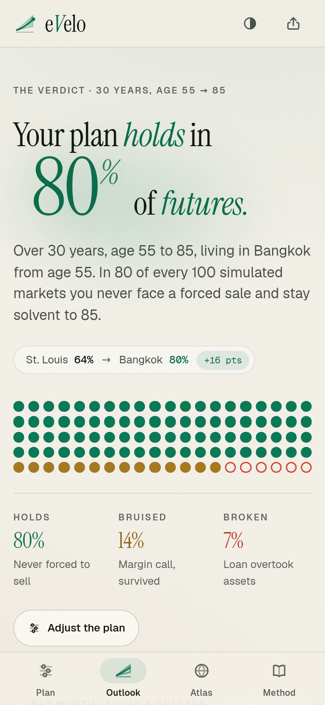

# eVelo

**Stress-test a Buy-Borrow-Die retirement across thousands of market futures, at home or abroad.**

Buy-Borrow-Die means living off a portfolio by borrowing against it instead of selling it, then
leaving it to heirs, who inherit with a stepped-up cost basis. It works until a crash forces a
sale. eVelo takes your real tickers, your budget and your borrowing terms, replays 33 years of
market history in thousands of different orders, and tells you how often the lender never has
to sell. It does this in your home city and in any of 96 cities abroad.


| Atlas | Phone |
| --- | --- |
|  |  |

## Features

- **One verdict.** "Your plan holds in 80% of futures", with 100 dots showing which futures hold,
  which survive a margin call (bruised) and which break.
- **Real portfolios.** 172 tickers (index funds, bond funds, sectors, 115 large stocks, REITs, gold,
  crypto) with monthly total returns since February 1993. Fuzzy ticker search (⌘K / Ctrl-K),
  locked weights and model portfolios.
- **The detail behind the verdict.** Net worth, portfolio, loan and loan-to-value fan charts in
  today's dollars. When margin calls tend to arrive. The most you can spend at 90% confidence,
  applied in one click. Borrow vs. sell estate comparison. A correlation heat map.
- **Living abroad.** Per-category cost ratios from city indices, an expat factor, a healthcare
  factor and a real exchange-rate random walk. The **Atlas** ranks all 96 cities on a dot-matrix
  world map, and you can compare up to three side by side.
- **Model controls.** Block bootstrap or fat-tail (Student-t) futures. Historical, balanced or
  conservative outlooks. Block length, path count and seed.
- **Method page.** A plain-language explainer of every step, with the model's real parameters
  and diagrams ([`#method`](#methodology)).
- Light and dark themes, built for phones first, keyboard accessible, and respects
  `prefers-reduced-motion`. Shareable links (`#p=…`) carry the whole plan, and your plan stays
  on your device.

## Methodology

This is the short version. The in-app **Method** page (`#method`) is the full explainer, and it
reads every number from the code.

1. **Data.** Yahoo Finance monthly adjusted closes give total returns. US CPI-U comes from FRED.
   Both are bundled at build time and refreshed weekly. FX rates come from open.er-api.com and
   update live in the browser when the service is reachable.
2. **Futures.** A stationary block bootstrap draws whole calendar months, in runs averaging 24
   months. Every asset and inflation share the same months, so crashes and co-movement are
   preserved. The alternative is a multivariate Student-t with 5 degrees of freedom.
3. **Taming short histories.** Months before a ticker existed are backfilled by regression on
   SPY plus resampled residuals. Mean returns are shrunk toward a CAPM-style prior with history
   weight `min(cap, n / (n + k))`, where the cap and k depend on the outlook and asset class.
4. **Borrowing.** Interest capitalizes monthly. Spending net of other income is drawn on the
   line. If loan-to-value goes above the margin-call threshold, shares are sold, with
   capital-gains tax taken from the proceeds, until LTV is back at the target. A future is
   **holds** (no forced sale, solvent), **bruised** (forced sale, survived) or **broken** (debt
   caught up with the assets).
5. **Abroad.** Destination spend is the home budget times per-category ratios (with the expat
   factor), times each future's CPI path, times a real-FX random walk.
6. **Estate.** On the same markets, borrowing (step-up, loan repaid) is compared with selling as
   you go (capital-gains tax paid along the way).

**Limits:** no estate tax (the 2026 federal exemption is $15M per person), no state taxes, a
fixed loan rate, simplified Social Security, and it assumes a lender will serve you abroad. See
the Method page for the full list.

## Develop

Requires Node 22 (see `.nvmrc`).

```sh
npm ci
npm run dev          # dev server (http://localhost:5173)
npm test             # vitest: engine, state, UI logic
npx tsc -b           # type check (also: npm run typecheck)
npm run build        # type check + production build into dist/
npm run preview      # serve dist/ locally
```

### Data refresh

```sh
npm run data:refresh # Yahoo + FRED -> src/data/market.json, derived src/data/market-index.json, FX -> src/data/fx.json
npm run data:fx      # FX rates only
npm run data:index   # rebuild market-index.json from market.json
```

The script fails loudly on missing months, a stale last month or missing currencies. A test
checks that `market-index.json` matches `market.json`. `.github/workflows/refresh-data.yml` runs
the refresh every Monday (and on manual dispatch), runs the tests, commits any changed data and
redeploys.

### Layout

- `src/engine/` is the pure TypeScript simulation and runs in a Web Worker. `types.ts` is the
  contract with the UI.
- `src/state/` holds the zustand store, the worker client, hash routing and share links.
- `src/ui/` holds the views (`plan`, `outlook`, `atlas`, `method`, `shell`) and `primitives`.
- `src/styles/` holds the design tokens (light and dark) and global CSS.
- `src/data/` holds the bundled market, FX and city cost data. The full return series
  (`market.json`) only ships in the worker chunk. The UI uses the small `market-index.json`.

## Deploy

eVelo is a static site with no backend. `vite.config.ts` sets `base: './'`, so `dist/` works from
any path on any static host: GitHub Pages, Netlify, Cloudflare Pages, S3 or a plain web server.
Routing is hash-based (`#plan`, `#atlas`, `#method`), so no rewrite rules are needed.

- **GitHub Pages:** `.github/workflows/deploy.yml` builds and deploys on every push to `main`.
  To enable it, set the repository's Settings → Pages → Source to "GitHub Actions".
- **Netlify and others:** use build command `npm run build` and publish directory `dist`.

## Disclaimer

eVelo is an educational planning tool, not financial, tax or legal advice. Its projections are
simulations based on historical data and simplifying assumptions. City costs, healthcare
factors and currency volatilities are estimates. Real lending terms, taxes and markets will
differ. Talk to a qualified adviser before borrowing against your investments.
